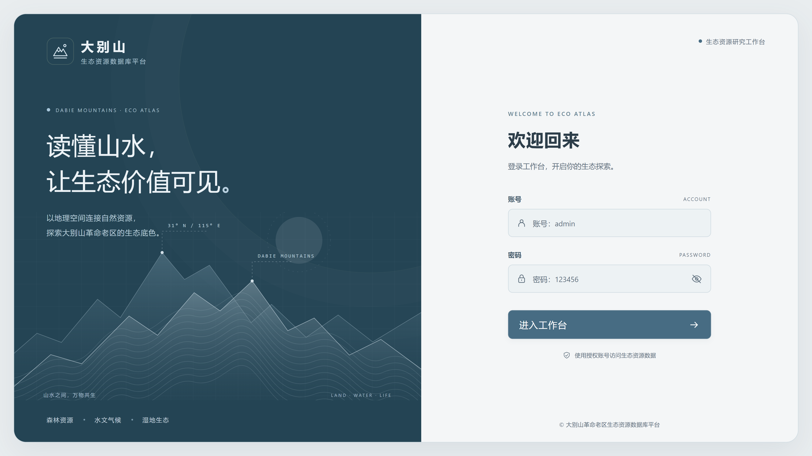
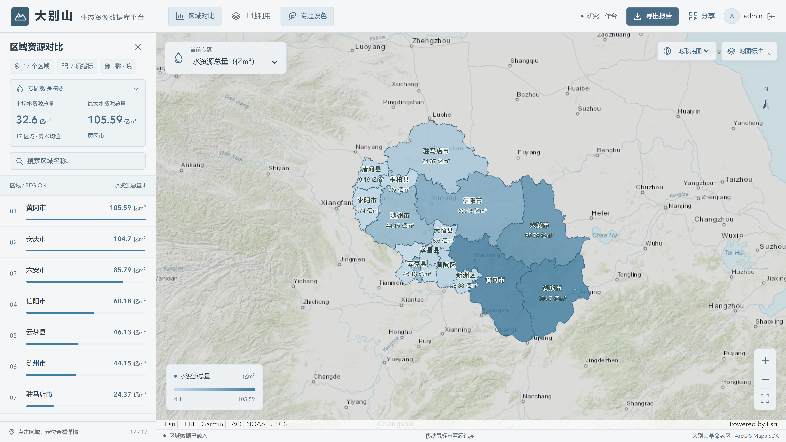
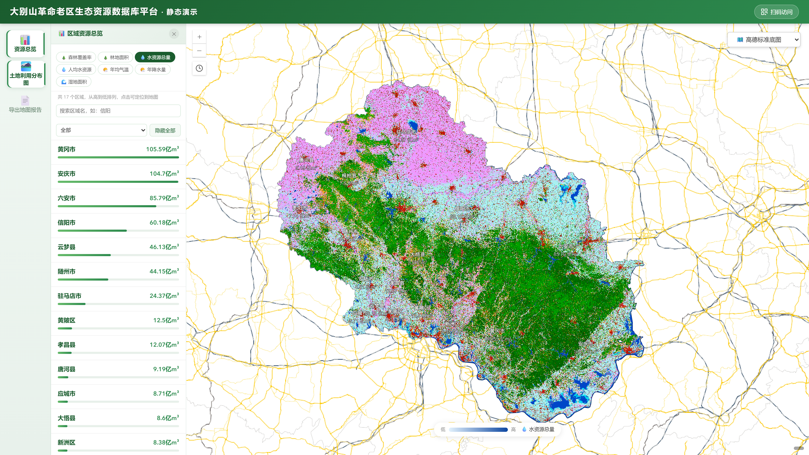

# 大别山革命老区生态资源展示平台

[](https://github.com/ichangli/dabieshan/actions/workflows/pages.yml)

Vue 3、TypeScript、ArcGIS Maps SDK 与 Node.js 实现的 WebGIS 项目。提供 17 个区域的生态指标浏览、检索定位、专题着色、土地利用图层、二维码分享及 HTML 报告导出。地图工作台采用可收起侧栏，摘要随当前指标动态展示区域均值、最高值及对应地区。

[在线演示](https://ichangli.github.io/dabieshan/) · [下载完整源码](https://github.com/ichangli/dabieshan/archive/refs/heads/main.zip) · [数据与依赖](docs/数据与依赖.md)

## 技术要点

- **多源地图叠加与坐标适配**：针对高德 GCJ-02 底图与 WGS84 业务数据叠加时的位置偏移，在自定义瓦片层中实现逐像素坐标映射与重采样，将显示适配集中在底图层，保持区域与土地利用数据原有坐标。实现见 [amapRasterLayer.ts](src/composables/amapRasterLayer.ts) 和 [gcj02.ts](src/utils/gcj02.ts)。
- **17 区域专题联动**：围绕统一的当前指标状态，联动地图着色、图例、区域排名与摘要；区域检索和定位配合地图标注，连接数值比较与空间分布观察。
- **数据预处理与静态部署**：通过脚本导出 GeoServer WFS 区域数据，按研究区范围计算 XYZ 瓦片行列号，并发导出土地利用影像。静态演示使用 17 份 GeoJSON 和 306 张本地瓦片，将地图业务展示从本机 GeoServer 服务中解耦，通过 GitHub Actions 构建并发布到 Pages。

## 项目展示

以下为当前完整本地版的浏览器实际运行截图，分辨率为 3840 × 2160。点击图片可查看高清原图；静态在线演示无需登录。

### 登录页面

卡片式登录界面采用山峦与等高线视觉，支持账号登录、密码显隐与错误反馈。

[](docs/images/login-hd.png)

### 专题图与区域对比

支持切换多项生态指标，通过连续色阶呈现 17 个区域的空间差异。专题切换时，地图配色、图例、区域排名与数据摘要同步更新，展示区域均值、最大值及对应地区，并支持区域检索定位与地图标注。下图为专题图功能示例。

[](docs/images/water-resources-hd.png)

### 土地利用分布

支持土地利用栅格叠加、图层开关与地图缩放，结合区域指标观察研究区的空间分布。左侧摘要和渐变图例随当前区域指标专题联动。

[](docs/images/land-use-hd.png)

## 快速体验静态版

安装 Node.js 22.12+（推荐 24），在项目目录执行：

```sh
npm ci
npm run dev:demo
```

打开终端显示的地址，路径为 `/dabieshan/`。此模式不需要 Node 业务服务或 GeoServer。默认显示 Esri 地形底图，可切换到高德标准底图；在线底图需要网络连接。

构建与预览：

```sh
npm run build:demo
npm run preview
```

通过预览服务器访问 `/dabieshan/`，以正确加载路由和静态资源。

## 实现与部署

### 两种运行方式

| | 静态演示 | 完整本地版 |
|---|---|---|
| 登录 | 无需登录 | Node 校验密码与 Token，支持注销 |
| 区域 | 随项目提供的 GeoJSON | GeoServer WFS |
| 土地利用 | 306 张本地 PNG 瓦片 | GeoServer WMTS |
| 后端 | 无 | Node + 自行配置的 GeoServer |
| 底图 | Esri 地形底图／高德标准底图 | Esri 地形底图／高德标准底图 |

### 本地登录与地图服务

1. `npm ci` 安装前端依赖。
2. 复制 `server/.env.example` 为 `server/.env`，设置本机账号和密码。
3. 启动本机 GeoServer（默认 localhost:8080）。在 `tif` 工作区发布 17 个与 `src/composables/config.ts` 中 REGIONS 同名的区域 WFS 图层，以及 `tif:cutting` WMTS。区域属性字段见 `public/data/regions` 示例；原始栅格与 GeoServer 数据目录没有包含在本仓库，需要自行提供。
4. 执行 `npm run dev:full`，打开 Vite 输出的根地址。

也可以分别运行 `npm run server` 和 `npm run dev`。Node 仅使用内置模块，默认绑定 127.0.0.1:3200。未创建 server/.env 时，本机示例账号为 admin，密码为 123456。

开发请求链：浏览器 → Vite 开发代理 → Node（校验 Token）→ GeoServer。部署完整服务时，需要另外配置 `dist` 静态托管和同源反向代理，将登录与地图请求转发到 Node；Vite 代理仅在开发服务器中生效。

`VITE_GEOSERVER_BASE` 默认留空，通过 Node 代理访问。填写远程 GeoServer 地址时，请配置对应服务的认证方式和 CORS。

### 底图与坐标

默认采用 [Esri World Topographic Map](https://server.arcgisonline.com/ArcGIS/rest/services/World_Topo_Map/MapServer)，通过 ArcGIS TileLayer 加载，在底图层上适度降低亮度和饱和度，让专题色阶与边界更易辨认。高德标准底图作为可选项，通过 ArcGIS 自定义瓦片层接入标准栅格服务。地图及 README 截图保留底图来源署名。

Esri 地形底图采用 Web Mercator；项目区域 GeoJSON 使用 WGS84，土地利用瓦片使用 Web Mercator 网格。高德底图的显示适配由 `amapRasterLayer.ts` 完成：从目标像素反算经纬度，映射到 GCJ-02 源像素，再读取相邻源瓦片并重采样输出。

当前高德栅格接入与 JS API 凭据独立。以后若切换到高德 JS API 引擎，需要单独接入，并配置相应凭据与允许域名。

### 数据预处理

已有本机 GeoServer 图层时，按顺序运行以下脚本更新静态演示资源；输出会写入 `public/data/regions/` 和 `public/tiles/cutting/`，请先保留需要的旧数据。

```sh
node scripts/export-regions.mjs
node scripts/export-tiles.mjs
```

- [export-regions.mjs](scripts/export-regions.mjs)：通过 WFS 导出 17 个区域的 GeoJSON。
- [export-tiles.mjs](scripts/export-tiles.mjs)：读取区域边界计算覆盖范围，按 Web Mercator XYZ 网格生成 0–10 级瓦片任务，以 6 路并发请求本机 `tif:cutting` WMTS，并保存为 PNG。

脚本中的 GeoServer 地址、图层名和输出参数可按本机配置调整。这里导出的是项目土地利用图层，底图仍通过在线服务加载。

### GitHub Pages

仓库保留 `src`、`server`、`scripts` 与 `public`。Actions 安装依赖、运行测试和类型检查并构建 demo，将 `dist` 发布到 Pages。Pages Source 应为 GitHub Actions；完整 Node 与 GeoServer 服务需独立部署。

演示路径目前固定 `/dabieshan/`，修改仓库名时需同步修改 vite.config.ts。演示使用 hash 路由，支持刷新。

## 目录

- `src/`：Vue 界面、地图、专题、报告与登录逻辑。
- `server/`：Node 登录、会话校验、注销和 GeoServer 代理。
- `public/data/regions/`：17 个区域 GeoJSON 快照。
- `public/tiles/cutting/`：0–10 级土地利用展示瓦片。
- `scripts/`：从本机 GeoServer 导出区域数据和瓦片的工具。
- `.github/workflows/`：构建与 Pages 发布配置。

## 验证

| 命令 | 用途 |
|---|---|
| `npm test` | 运行项目测试 |
| `npm run type-check` | 检查 TypeScript 与 Vue 类型 |
| `npm run build:demo` | 检查类型并构建静态演示 |
| `npm run build` | 检查类型并构建完整模式前端 |

## 已知限制

- **数据口径**：区域指标为项目数据快照，原始出处、统计年份及口径仍待补充核实。区域涉及不同面积与行政层级，比较时需结合指标含义；现有展示适用于作品演示，正式研究或决策应另行核验数据。
- **土地利用展示**：当前使用渲染瓦片，功能聚焦图层浏览与叠加。分类图例、实时面积计算和变化分析仍待完善；瓦片覆盖 0–10 级，超出层级或研究区范围时可能缺少影像。
- **坐标精度**：高德底图适配采用显示用近似转换，尚未通过独立控制点精度验收，适用范围为可视化叠加。
- **账号与部署**：账号系统用于本地学习和服务联调，采用配置密码及内存会话，Node 重启会清空会话。公网部署前需完善密码哈希、会话到期、限流和权限管理等机制。构建检查覆盖代码与产物，GeoServer 图层配置和数据质量需单独验证。

## 许可证与第三方说明

本项目原创代码与原创文档采用 [MIT License](LICENSE)。第三方 SDK、运行资源、底图影像、区域数据与土地利用瓦片按各自权利声明和许可使用，MIT 许可不授予这些第三方内容的使用或再分发权利。

底图使用需遵循服务提供方条款，并保留来源署名。高德自定义瓦片接入与重采样的具体授权范围仍待向服务方确认；公开演示、部署或再分发时应结合实际用途核实相应许可。许可文件、数据说明和官方条款链接集中见 [数据与依赖](docs/数据与依赖.md)。
